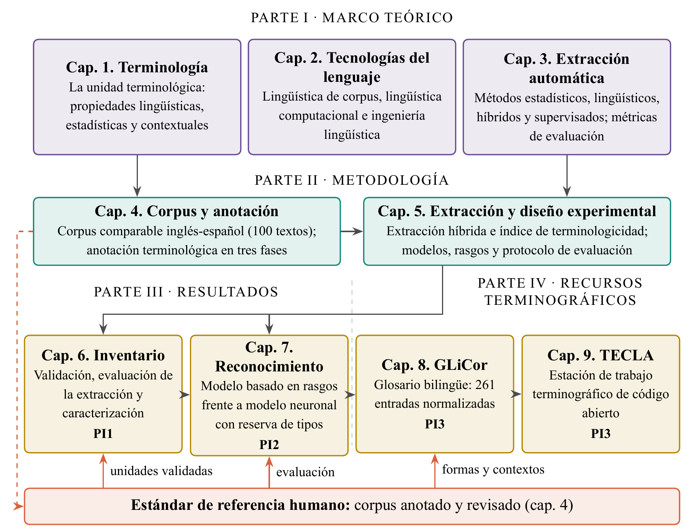
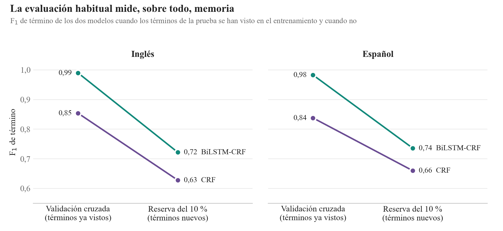
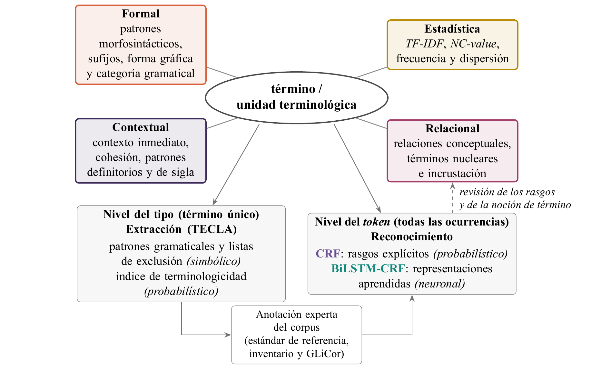

# Material complementario de la tesis doctoral

**Modelo teórico-computacional para la extracción automática de términos: una aproximación desde las tecnologías del lenguaje**

Isabel Moyano Moreno · Universidad de Cádiz, 2026
Dirección: Prof. Dr. Miguel Casas Gómez y Prof. Dr. Mario Crespo Miguel

**Índice:** [La tesis en una figura](#la-tesis-en-una-figura) · [Resumen](#resumen) · [Abstract](#abstract) · [Resultados destacados](#resultados-destacados) · [Recursos que derivan de la tesis](#recursos-que-derivan-de-la-tesis) · [Qué es este material](#qué-es-este-material) · [Por dónde empezar](#por-dónde-empezar) · [Documentos para leer (PDF)](#documentos-para-leer-pdf) · [Datos en tablas (CSV)](#datos-en-tablas-csv) · [Código](#código) · [Qué no se publica](#qué-no-se-publica) · [Términos técnicos que aparecen en los ficheros](#términos-técnicos-que-aparecen-en-los-ficheros) · [Licencia y cita](#licencia-y-cita)

## La tesis en una figura

La tesis se organiza en cuatro partes y nueve capítulos. En la base de todo está el corpus anotado y revisado a mano, del que salen el inventario de términos, la evaluación de los modelos y el glosario.

## Resumen

Esta tesis se pregunta qué hace de una unidad léxica un término y hasta qué punto esa condición puede reconocerse automáticamente y sistematizarse en recursos terminográficos abiertos, a partir del caso de la lingüística de corpus. Su hipótesis general es que la terminologicidad no es una propiedad intrínseca ni categórica de las unidades, sino gradual, pues surge de su uso en el discurso especializado, donde se manifiesta en regularidades lingüísticas, estadísticas o contextuales observables. Ninguna de ellas basta por sí sola, pero su análisis conjunto permite caracterizar el término, formalizarlo en un modelo computacional, así como sistematizar el trabajo terminográfico en recursos reproducibles. La tesis sostiene, en consecuencia, que la descripción lingüística, con su capacidad de abstracción, y los medios computacionales son enfoques complementarios. La lingüística aporta los criterios que definen el término, los rasgos con que se representa, así como la anotación con que se evalúa, mientras que la computación permite contrastarlos a gran escala para devolver a la teoría qué propiedades son realmente constitutivas del término. La investigación se desarrolla en el dominio de la lingüística de corpus, a partir de un corpus comparable inglés-español de 100 textos académicos (alrededor de 1,3 millones de *tokens* en inglés, 850 000 en español), anotado y revisado manualmente, término a término, por una especialista del dominio. Ese corpus, estándar de referencia humano de toda la investigación, se somete a un marco de cuatro pruebas (cobertura, saturación, dispersión, estabilidad) que comprueba su adecuación para las tareas a las que sirve.

Los candidatos a término se obtienen mediante una extracción híbrida, que combina una gramática de patrones morfosintácticos con un índice de terminologicidad, para validarse después en contexto. El inventario resultante reúne 261 unidades normalizadas (151 términos, 110 entidades). Su descripción muestra que las dos lenguas comparten un núcleo conceptual, aunque forman sus términos de manera distinta, mientras que la terminología sigue las leyes estadísticas del léxico general de forma aún más concentrada. Frente a este inventario, como también en ACTER, la extracción híbrida recupera más términos en la parte alta de la lista que un método solo estadístico o solo lingüístico. El contraste de los modelos de aprendizaje automático con la anotación experta pone de manifiesto que la evaluación habitual en PLN no se ajusta a la tarea terminográfica que plantea esta tesis, ya que mide sobre todo la memoria de términos ya vistos durante el entrenamiento. Por ello, se diseña un protocolo de evaluación que reserva términos completos para la prueba y mide la capacidad de reconocer términos nuevos, con el que se ponen a prueba dos modelos, uno basado en rasgos explícitos y diseñados manualmente (CRF) y otro neuronal (BiLSTM-CRF). Ambos generalizan de manera complementaria, y sus resultados se integran en un modelo teórico-computacional del término que tiene en cuenta su dimensión formal o lingüística, estadística, contextual y relacional. Por último, el procedimiento se sistematiza en dos recursos abiertos, el glosario digital bilingüe GLiCor, con 261 entradas documentadas en el corpus, así como TECLA, una estación de trabajo terminográfico de código abierto, con interfaz gráfica, que permite replicarlo en otros dominios. Los resultados respaldan, con matices, la hipótesis general, ya que de las diez hipótesis de trabajo ninguna resulta refutada, seis se confirman tal como se formularon, mientras que cuatro lo hacen parcialmente.

## Abstract

This thesis asks what makes a lexical unit a term and to what extent that status can be recognised automatically and systematised in open terminographic resources, taking corpus linguistics as a case study. Its general hypothesis is that termhood is neither an intrinsic nor a categorical property of lexical units but a gradual one, since it emerges from their use in specialised discourse, where it manifests itself in observable linguistic, statistical or contextual regularities. None of them suffices on its own, but their joint analysis makes it possible to characterise the term, to formalise it in a computational model, as well as to systematise terminographic work in reproducible resources. The thesis consequently argues that linguistic description, with its capacity for abstraction, and computational means are complementary approaches. Linguistics provides the criteria that define the term, the features with which it is represented, as well as the annotation with which it is evaluated, whereas computation makes it possible to test them on a large scale in order to feed back into theory which properties are truly constitutive of the term. The research is carried out in the domain of corpus linguistics, on the basis of a comparable English–Spanish corpus of 100 academic texts (around 1.3 million *tokens* in English, 850,000 in Spanish), manually annotated and revised term by term by a domain expert. This corpus, the human gold standard of the whole study, undergoes a framework of four tests (coverage, saturation, dispersion, stability) that assesses its adequacy for the tasks it serves.

Term candidates are obtained through a hybrid extraction, which combines a grammar of morphosyntactic patterns with a termhood index, before being validated in context. The resulting inventory comprises 261 normalised units (151 terms, 110 entities). Its description shows that the two languages share a conceptual core although they form their terms differently, whereas terminology follows the statistical laws of the general lexicon in an even more concentrated form. Measured against this inventory, as well as on ACTER, the hybrid extraction retrieves more terms at the top of the list than a purely statistical or purely linguistic method. Contrasting machine learning models with the expert annotation reveals that standard evaluation in NLP does not fit the terminographic task addressed in this thesis, since it mainly measures the memory of terms already seen during training. An evaluation protocol is therefore designed that holds out whole terms for testing and measures the ability to recognise new terms, and two models are tested with it, one based on explicit, manually designed features (CRF) and a neural one (BiLSTM-CRF). Both generalise in complementary ways, and their results are brought together in a theoretical-computational model of the term that takes into account its formal or linguistic, statistical, contextual and relational dimensions. Finally, the procedure is systematised in two open resources, the bilingual digital glossary GLiCor, with 261 entries documented in the corpus, as well as TECLA, an open-source terminographic workstation with a graphical interface that allows it to be replicated in other domains. The results support the general hypothesis, with some qualifications, since none of the ten working hypotheses is refuted, six are confirmed as formulated, whereas four are partially confirmed.

## Resultados destacados

**Un corpus bilingüe anotado con términos.** 100 textos académicos de lingüística de corpus, 50 en inglés y 50 en español (1,33 millones de *tokens* en inglés y 849 000 en español, sin las referencias bibliográficas), anotados y revisados a mano, aparición por aparición: 30 540 apariciones de términos en inglés y 18 469 en español, además de las de las entidades. Es el estándar de referencia de toda la tesis y uno de los pocos conjuntos de datos en español anotados con términos. La relación de los textos está en el [registro documental del corpus](corpus/registro_documental_corpus.pdf), y sus estadísticas, en [`corpus/`](corpus/).

**Un marco para evaluar la adecuación terminológica de un corpus.** No se pregunta si el corpus es representativo en abstracto, sino si sirve para lo que se usa: describir la terminología, compilar un glosario y entrenar y evaluar modelos. Combina cuatro pruebas, aplicables a cualquier corpus especializado e integradas en [TECLA](https://isabel-mm.github.io/TECLA/):

| Prueba | Qué mide | Inglés | Español |
|---|---|---|---|
| Cobertura | Términos del glosario de referencia CASS presentes en el corpus | 38/38 (100 %) | 37/38 (97,4 %) |
| Saturación | Exponente β de la ley de Heaps (cuanto más bajo, antes deja de crecer el vocabulario) | 0,564 | 0,538 |
| Dispersión | DP medio de los 50 términos más frecuentes (0 = repartidos; 1 = concentrados) | 0,536 | 0,499 |
| Estabilidad | Proporción de los 30 términos más frecuentes que se mantienen al remuestrear los documentos | 0,839 | 0,890 |

**La evaluación habitual mide, sobre todo, memoria.** Cuando los términos de la prueba ya se han visto en el entrenamiento, los dos modelos parecen casi perfectos. Cuando se les piden términos nuevos (protocolo de reserva de tipos), el rendimiento cae de forma notable. Las cifras completas están en [`reconocimiento_automatico/`](reconocimiento_automatico/).

**Un modelo teórico-computacional del término.** Los resultados se reúnen en un modelo con cuatro dimensiones (formal, estadística, contextual y relacional) que operan en dos niveles: el del tipo, en el que la extracción con [TECLA](https://github.com/isabel-mm/TECLA) delimita y ordena los candidatos, y el de cada aparición en el texto, en el que los modelos reconocen los términos. La dimensión relacional, la relación con los términos ya conocidos, es la que más ayuda a reconocer términos nuevos.

## Recursos que derivan de la tesis

  
  &nbsp;&nbsp;&nbsp;&nbsp;
  

  <a href="https://isabel-mm.github.io/GLiCor/"><b>GLiCor</b>, glosario bilingüe de lingüística de corpus</a> ·
  <a href="https://isabel-mm.github.io/TECLA/"><b>TECLA</b>, estación de trabajo terminográfico</a> ·
  <a href="https://github.com/isabel-mm/TECLA">código de TECLA</a>

- **[GLiCor](https://isabel-mm.github.io/GLiCor/)**: glosario bilingüe inglés-español de lingüística de corpus, con 261 entradas (151 términos y 110 entidades), documentadas en el corpus. Sus datos y su registro de normalización están en [`glosario_GLiCor/`](glosario_GLiCor/).
- **[TECLA](https://isabel-mm.github.io/TECLA/)** (*Term Extraction and Corpus Linguistics Application*): estación de trabajo terminográfico de código abierto, con aplicación de escritorio para Windows y macOS y librería de Python, que reproduce todo el procedimiento de la tesis. Código: <https://github.com/isabel-mm/TECLA>.

## Qué es este material

La tesis resume en tablas y figuras lo que aquí se ofrece completo: la relación de los textos del corpus, el inventario de términos, el registro de las decisiones del glosario y los resultados de todos los experimentos. Sirve para consultar con detalle lo que el texto resume y para comprobar sus cifras.

**No hace falta saber programar.** Los documentos principales están en PDF, y los datos, en tablas que se abren con una hoja de cálculo (Excel, LibreOffice Calc, Google Sheets). El código solo interesa a quien quiera repetir los experimentos.

## Por dónde empezar

| Si quiere… | Abra… |
|---|---|
| ver qué textos forman el corpus | [`corpus/registro_documental_corpus.pdf`](corpus/registro_documental_corpus.pdf) |
| ver los criterios con que se anotaron los términos | [`anotacion_de_terminos/README.md`](anotacion_de_terminos/README.md) |
| ver los 38 términos de partida (glosario CASS) y sus equivalentes en español | [`glosario_de_partida_CASS/cobertura_glosario_cass.pdf`](glosario_de_partida_CASS/cobertura_glosario_cass.pdf) |
| consultar todos los términos y entidades del corpus, con su frecuencia y su terminologicidad | [`inventario_de_terminos/inventario_bilingue.pdf`](inventario_de_terminos/inventario_bilingue.pdf) |
| consultar el glosario bilingüe GLiCor | su versión web: <https://isabel-mm.github.io/GLiCor/> |
| saber por qué el glosario agrupa, separa o nombra así cada entrada | [`glosario_GLiCor/registro_normalizacion_glosario.pdf`](glosario_GLiCor/registro_normalizacion_glosario.pdf) |
| consultar todos los resultados de los modelos de reconocimiento de términos | [`reconocimiento_automatico/resultados_completos.pdf`](reconocimiento_automatico/resultados_completos.pdf) |
| ver las figuras de la tesis en alta resolución | [`figuras/`](figuras/) |

## Documentos para leer (PDF)

Tienen el mismo formato que la tesis y pueden leerse por separado.

- **Registro documental del corpus** (`corpus/`, 11 págs.): la referencia bibliográfica de los 100 documentos del corpus, 50 en inglés y 50 en español, ordenados por lengua y tipo de publicación.
- **Cobertura del glosario de referencia** (`glosario_de_partida_CASS/`, 2 págs.): los 38 términos del glosario CASS que sirvieron de punto de partida de la anotación, con sus equivalentes en español y la fuente de cada uno.
- **Inventario bilingüe de términos y entidades** (`inventario_de_terminos/`, 18 págs.): todas las unidades validadas de cada lengua, ordenadas por terminologicidad, con sus frecuencias y medidas estadísticas.
- **Registro de normalización del glosario** (`glosario_GLiCor/`, 28 págs.): las decisiones con que se reúnen en una sola entrada las variantes, siglas y sinónimos de cada concepto, y el método con que se cuentan sus frecuencias.
- **Resultados completos e hiperparámetros** (`reconocimiento_automatico/`, 8 págs.): el entorno de trabajo, la configuración de los modelos y los resultados desglosados que el capítulo 7 resume.

## Datos en tablas (CSV)

Cada carpeta corresponde a un capítulo de la tesis y lleva su propio README, que explica qué contiene cada columna.

| Carpeta | Qué contiene | Capítulo |
|---|---|---|
| [`corpus/`](corpus/) | Los documentos del corpus: referencia, año, autoría, tipo y tamaño de cada uno; totales por lengua; pruebas de que el corpus es adecuado para estudiar la terminología del dominio (cobertura, crecimiento del vocabulario, dispersión, estabilidad). | 4 |
| [`glosario_de_partida_CASS/`](glosario_de_partida_CASS/) | Los términos de CASS y sus equivalentes, y cuántas veces aparece cada uno en el corpus. | 4 |
| [`anotacion_de_terminos/`](anotacion_de_terminos/) | Criterios de anotación; todas las formas que se anotan de cada entrada (siglas, variantes, sinónimos, préstamos); apariciones anotadas de cada entrada. | 4 |
| [`inventario_de_terminos/`](inventario_de_terminos/) | El inventario de términos y entidades de cada lengua con sus medidas: frecuencia, número de documentos, *TF-IDF*, *C-value*, *NC-value* e índice de terminologicidad. | 6 |
| [`distribucion_de_los_terminos/`](distribucion_de_los_terminos/) | Distribución de los términos: frecuencias ordenadas (ley de Zipf), curvas de saturación (cuántos términos nuevos aparecen al añadir textos) y estructura de las unidades. | 6 |
| [`glosario_GLiCor/`](glosario_GLiCor/) | Las 261 entradas de GLiCor y su registro de normalización, en formato JSON (el que usa la versión web). | 8 |
| [`reconocimiento_automatico/`](reconocimiento_automatico/) | Rasgos e hiperparámetros de los modelos y resultados de todas las ejecuciones: rendimiento, comparación con clasificadores sencillos, ablación por familias de rasgos, análisis de errores. | 5 y 7 |

**Cómo abrir un CSV en Excel con la configuración española.** Si las columnas aparecen juntas o los decimales salen mal, no abra el fichero con doble clic: use *Datos → Obtener datos → Desde texto/CSV* y elija como origen *UTF-8*, como delimitador la *coma* y, como configuración regional, una que use el *punto* como separador decimal (por ejemplo, *Inglés (Estados Unidos)*). LibreOffice Calc pregunta todo esto al abrir el fichero.

## Código

Las carpetas `scripts/` contienen el código, en Python, con que se han obtenido los datos y los resultados, tal como se ejecutó. La lista de librerías necesarias está en `reconocimiento_automatico/scripts/requirements.txt`. TECLA, la librería de extracción terminológica desarrollada en la tesis (capítulo 9), tiene su propio repositorio: <https://github.com/isabel-mm/TECLA>.

## Qué no se publica

Los **textos del corpus** son publicaciones académicas sujetas a derechos de autor, por lo que no se distribuyen; el registro documental permite localizar cada uno. Por la misma razón no se publican los ficheros de anotación palabra a palabra, que permitirían reconstruir los textos. Las predicciones de los modelos se publican sin las palabras: solo con la posición de cada palabra y sus etiquetas. Ambos están disponibles a petición para la evaluación de la tesis.

## Términos técnicos que aparecen en los ficheros

- ***Token***: cada palabra o signo del texto tal como aparece; es la unidad con que se mide el tamaño del corpus.
- **Tipo**: cada unidad distinta, con independencia de cuántas veces aparezca. *Corpus* es un tipo con miles de apariciones.
- **Entrada**: una entrada de GLiCor, que reúne todas las formas de un mismo concepto (singular y plural, sigla y forma desarrollada, sinónimos).
- **Término y entidad**: la tesis distingue los términos, que designan conceptos (*corpus de referencia*), de las entidades, nombres propios de corpus, herramientas y estándares (*BNC*, *Sketch Engine*, *XML*).
- **Etiquetas `B-T`, `I-T` y `O`**: forma de marcar los términos palabra a palabra. `B-T` señala la primera palabra de un término; `I-T`, las siguientes, y `O`, las palabras que no forman parte de ningún término. En *el corpus de referencia*, *el* es `O`, *corpus* es `B-T` y *de* y *referencia* son `I-T`. `B-E` e `I-E` hacen lo mismo con las entidades.
- **Unidad** (*span*): un término completo, de su primera a su última palabra.
- **Precisión, recuperación y F₁**: la precisión es la proporción de lo que el modelo marca como término que realmente lo es; la recuperación, la proporción de los términos del texto que el modelo encuentra, y el F₁, una media de las dos. La tesis usa como medida principal el **F₁ de término**.
- **Reserva de tipos**: el procedimiento de evaluación de la tesis. Se aparta al azar una parte de los términos (el 10, 20, 30 o 50 %) y se evalúa a los modelos con textos que los contienen, de modo que tienen que reconocer términos que nunca han visto.
- **Semilla o repetición**: cada uno de los sorteos de la reserva de tipos. El experimento se repite con varios sorteos y se da la media.
- **Validación cruzada**: la evaluación habitual, que reparte las oraciones al azar entre entrenamiento y prueba. La tesis la usa como contraste, porque sobreestima lo que los modelos han aprendido.
- **CRF**: el modelo basado en rasgos, que reconoce los términos a partir de 27 propiedades lingüísticas y estadísticas de cada palabra.
- **BiLSTM-CRF**: el modelo neuronal, que aprende por sí mismo sus representaciones de las palabras a partir del corpus.
- ***Baseline***: los clasificadores sencillos con que se comparan los modelos.
- **Ablación**: experimento en que se retira una familia de rasgos y se mide cuánto empeora el modelo, para saber qué aporta cada una.
- ***TF-IDF***, ***C-value***, ***NC-value*** e **índice de terminologicidad**: medidas estadísticas de hasta qué punto una unidad es característica del dominio; el índice de terminologicidad de la tesis combina el *TF-IDF* y el *NC-value*.

## Licencia y cita

Los datos se publican con licencia [CC BY 4.0](https://creativecommons.org/licenses/by/4.0/deed.es) y el código, con licencia MIT (véase `LICENSE.md`). Para citar este material, véase `CITATION.cff`.

